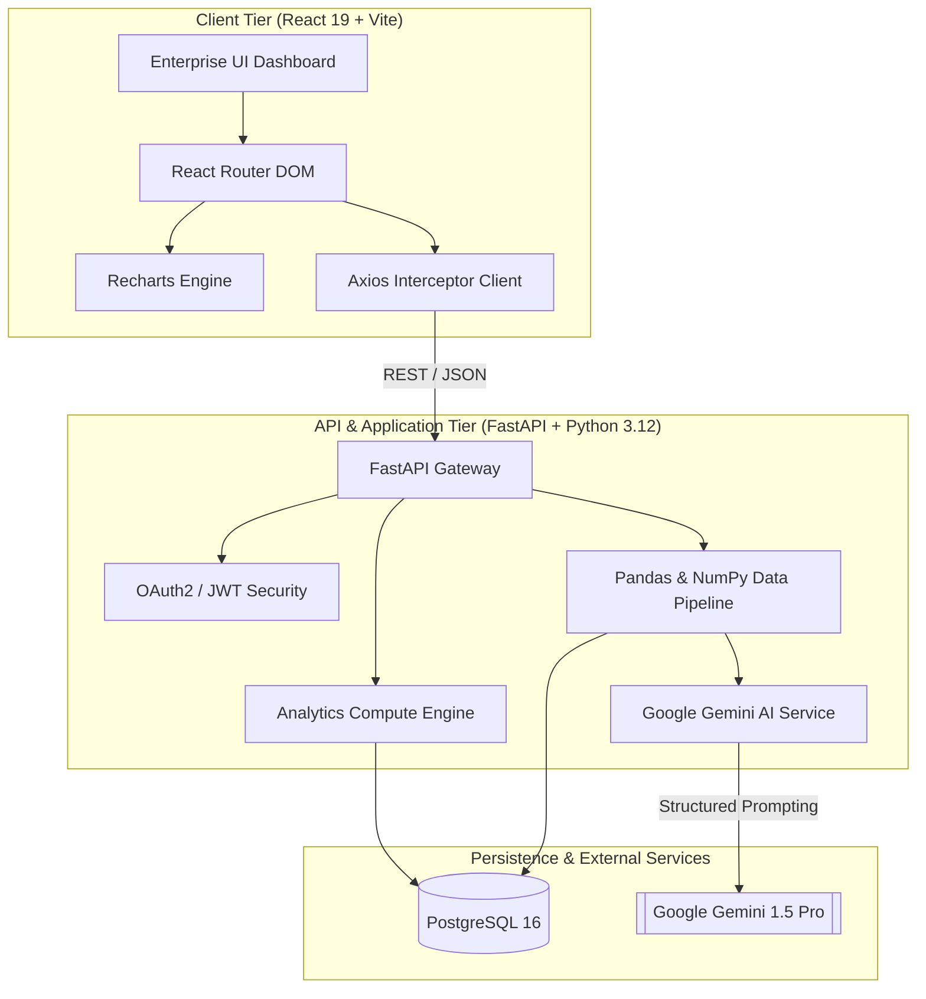

# InsightForge AI

> **AI-Powered Enterprise Data Intelligence Platform**  
> *Production-grade enterprise SaaS architecture tailored for mission-critical telemetry, analytics, and executive decision intelligence.*

---

## 🏛️ System Architecture



---

## 🚀 Tech Stack

| Layer | Technologies |
| :--- | :--- |
| **Frontend** | React 19, Vite, Tailwind CSS, React Router DOM, Axios, Recharts |
| **Backend** | Python 3.12, FastAPI, SQLAlchemy 2.0 (AsyncIO), Pydantic v2, Uvicorn |
| **Database** | PostgreSQL 16, Alembic Migrations |
| **AI / LLM** | Google Gemini API (`gemini-1.5-pro`) |
| **Data Processing** | Pandas, NumPy |
| **DevOps & Containers** | Docker, Docker Compose |
| **Deployment Targets** | Vercel (Frontend), Render (Backend & Managed PostgreSQL) |

---

## 📁 Repository Structure

```
InSightForge AI/
├── .github/
│   └── workflows/
│       ├── ci.yml                     # Continuous Integration pipeline
│       └── deploy.yml                 # Continuous Deployment pipeline
├── .env.example                       # Root environment variable template
├── .gitignore                         # Enterprise gitignore configuration
├── docker-compose.yml                 # Production multi-container orchestration
├── docker-compose.override.yml.example# Development volume mount overrides
├── render.yaml                        # Render Blueprint specification
├── vercel.json                        # Vercel SPA routing & security headers
├── README.md                          # Project documentation
│
├── frontend/                          # Client Application (React 19 + Vite)
│   ├── public/
│   │   ├── logo.svg
│   │   └── robots.txt
│   ├── src/
│   │   ├── assets/
│   │   │   └── index.css              # Tailwind base, components, utilities
│   │   ├── components/
│   │   │   ├── ai/                    # Gemini prompt & insight components
│   │   │   │   ├── AiResponseCard.jsx
│   │   │   │   ├── InsightQueryBox.jsx
│   │   │   │   └── PromptHistory.jsx
│   │   │   ├── charts/                # Recharts visualizations
│   │   │   │   ├── AnalyticsLineChart.jsx
│   │   │   │   ├── DistributionPieChart.jsx
│   │   │   │   ├── KpiMetricCard.jsx
│   │   │   │   └── MetricsBarChart.jsx
│   │   │   ├── common/                # Reusable UI atomic components
│   │   │   │   ├── Badge.jsx
│   │   │   │   ├── Button.jsx
│   │   │   │   ├── Card.jsx
│   │   │   │   ├── Input.jsx
│   │   │   │   ├── Modal.jsx
│   │   │   │   └── Spinner.jsx
│   │   │   └── layout/                # Shell layout & navigation
│   │   │       ├── AppLayout.jsx
│   │   │       ├── Footer.jsx
│   │   │       ├── Navbar.jsx
│   │   │       └── Sidebar.jsx
│   │   ├── context/                   # React Context Providers
│   │   │   ├── AuthContext.jsx
│   │   │   └── ThemeContext.jsx
│   │   ├── hooks/                     # Custom React Hooks
│   │   │   ├── useAuth.js
│   │   │   ├── useDataset.js
│   │   │   └── useInsights.js
│   │   ├── pages/                     # Routed View Controllers
│   │   │   ├── Analytics.jsx
│   │   │   ├── Dashboard.jsx
│   │   │   ├── Datasets.jsx
│   │   │   ├── Intelligence.jsx
│   │   │   ├── Login.jsx
│   │   │   ├── NotFound.jsx
│   │   │   └── Settings.jsx
│   │   ├── routes/                    # Route trees & protected gateways
│   │   │   ├── AppRoutes.jsx
│   │   │   └── ProtectedRoute.jsx
│   │   ├── services/                  # Axios HTTP client abstractions
│   │   │   ├── api.js
│   │   │   ├── authService.js
│   │   │   ├── datasetService.js
│   │   │   └── intelligenceService.js
│   │   ├── utils/                     # Formatting & constants
│   │   │   ├── constants.js
│   │   │   └── formatters.js
│   │   ├── App.jsx                    # Root Application Component
│   │   └── main.jsx                   # React 19 Entrypoint
│   ├── .dockerignore
│   ├── .env.example
│   ├── Dockerfile                     # Multi-stage production Nginx image
│   ├── index.html
│   ├── nginx.conf
│   ├── package.json
│   ├── postcss.config.js
│   ├── tailwind.config.js
│   └── vite.config.js
│
└── backend/                           # Enterprise API (Python 3.12 + FastAPI)
    ├── alembic/                       # Database schema migrations
    │   ├── versions/
    │   ├── env.py
    │   ├── script.py.mako
    │   └── README
    ├── app/
    │   ├── api/
    │   │   └── v1/
    │   │       ├── endpoints/         # FastAPI Route Controllers
    │   │       │   ├── analytics.py
    │   │       │   ├── auth.py
    │   │       │   ├── datasets.py
    │   │       │   ├── intelligence.py
    │   │       │   └── users.py
    │   │       └── router.py          # Unified V1 Router
    │   ├── core/                      # Core configuration & runtime
    │   │   ├── config.py
    │   │   ├── database.py
    │   │   ├── logging.py
    │   │   └── security.py
    │   ├── db/                        # Database ORM session & base
    │   │   ├── base.py
    │   │   ├── init_db.py
    │   │   └── session.py
    │   ├── models/                    # SQLAlchemy Declarative Models
    │   │   ├── analysis_job.py
    │   │   ├── dataset.py
    │   │   ├── insight_report.py
    │   │   └── user.py
    │   ├── schemas/                   # Pydantic v2 Serialization Schemas
    │   │   ├── analytics.py
    │   │   ├── dataset.py
    │   │   ├── intelligence.py
    │   │   ├── token.py
    │   │   └── user.py
    │   ├── services/                  # Business Engine Abstractions
    │   │   ├── analytics_service.py
    │   │   ├── data_processor.py
    │   │   └── gemini_service.py
    │   ├── utils/                     # Helpers & Upload Validators
    │   │   ├── helpers.py
    │   │   └── validators.py
    │   └── main.py                    # Application Entrypoint & Lifespan
    ├── tests/                         # Pytest asynchronous test suite
    │   ├── conftest.py
    │   ├── test_auth.py
    │   ├── test_datasets.py
    │   └── test_intelligence.py
    ├── .dockerignore
    ├── .env.example
    ├── alembic.ini
    ├── Dockerfile                     # Multi-stage Python 3.12 Slim image
    └── requirements.txt
```

---

## ⚡ Quick Start

### 1. Prerequisites
- Docker Engine & Docker Compose
- Node.js 22+ (for local frontend dev)
- Python 3.12+ (for local backend dev)

### 2. Launch with Docker Compose
```bash
# Clone and enter the repository
cd "InsightForge AI"

# Copy environment variables
cp .env.example .env

# Spin up Postgres, FastAPI, and Vite/Nginx
docker compose up --build
```
- Frontend: `http://localhost:3000`
- Backend API Docs (Swagger): `http://localhost:8000/api/v1/docs`
- Health Check: `http://localhost:8000/api/v1/health`

---

## 🌐 Cloud Deployment

### Frontend (Vercel)
- Root Directory: `frontend`
- Build Command: `npm run build`
- Output Directory: `dist`
- Configured via `vercel.json`

### Backend (Render)
- Deploy as a Web Service using `render.yaml` Blueprint or native Docker runtime.
- Attach Render Managed PostgreSQL.
